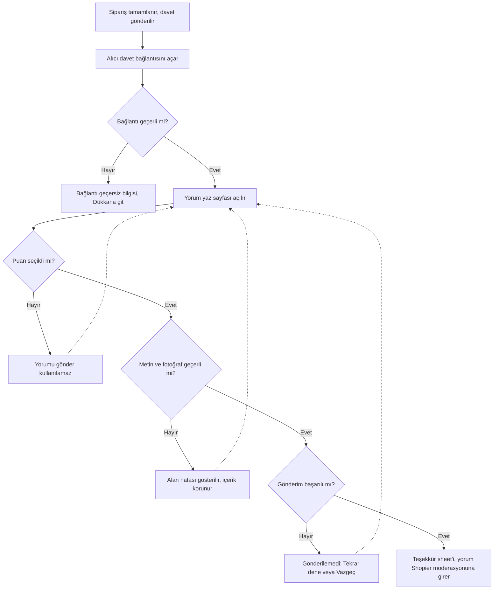
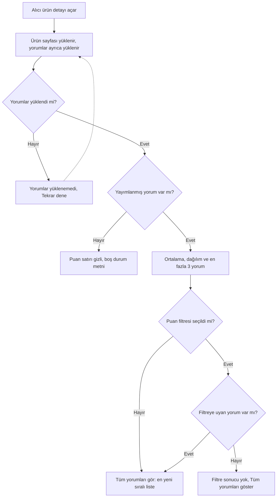

# PRD: Ürün yorumları — “Dükkan sayfalarındaki ürün detayından ürün yorumları yapılabilsin ve görüntülenebilsin”

**Taslak v0.1** · **Tarih:** 31 Ekim 2026 · **Sahip:** ipek şimşek, PM (Product Lead: İmge Aksoy) · **Kaynak:** `arastirma.md` / `arastirma.html` (rakip ve mevzuat benchmark'ı; görüşme katılımcısı yok, K1–Kn kullanılmadı), `tasarim.md` / `tasarim.html` · **İlgili içgörü:** yok (kullanıcı görüşmesi analizi bağlanmadı)

> Siparişi tamamlanmış alıcı, sipariş sonrası gelen davetle ürüne puan, metin ve fotoğrafla yorum bırakabilir; dükkan ziyaretçileri bu doğrulanmış yorumları ürün detay sayfasında görebilir ve satıcı yoruma herkese açık cevap verebilir.

## Netleşen kararlar (31 Ekim 2026)

Aşağıdakiler PM ve Product Lead'in onayladığı araştırma ve tasarımdan gelir; bu turda ayrıca soru-cevap yapılmadı.

- **Yön:** Araştırmadaki B seçeneği onaylandı (siparişe bağlı, doğrulanmış yorum; fotoğraf; sipariş sonrası davet; satıcı cevabı; Shopier moderasyonu). Kaynak: `arastirma.md` Seçenekler, onay kaydı `durum.md`.
- **Kim yazar:** Yalnızca siparişi olan alıcı yorum yazar. Ürün sayfasında herkese açık “yorum yaz” girişi yoktur. Kaynak: `tasarim.md` Yön ve Varsayımlar (onaylı tasarım).
- **Yorum içeriği:** 1–5 puan, metin, isteğe bağlı fotoğraf. Video bu fazda yok (bkz. Açık soru 11).
- **Doğrulanmış alıcı:** Yayımlanan her yorumda “Doğrulanmış alıcı” etiketi görünür.
- **Satıcı yetkisi:** Satıcı yoruma herkese açık cevap verebilir ve kural ihlalini Shopier'e bildirebilir. Satıcı yorumu silemez, gizleyemez, düzenleyemez.
- **Moderasyon:** Yorumların moderasyonunu Shopier yapar.
- **Görüntüleme:** Ürün detay sayfasında ortalama puan, puan dağılımı, puana göre filtre, en fazla 3 yorum ve tüm yorumlar sayfası vardır. Yorumu olmayan üründe puan satırı gösterilmez, boş durum metni gösterilir.
- **Kapsam:** Yorum ürüne yapılır (satıcı/dükkan puanı yok; bkz. Açık soru 2'deki öneri).

## 1. Amaç ve Problem Tanımı (Why)

### Problem

Shopier dükkanlarının ürün detay sayfasında alıcının başka alıcıların deneyimini görebileceği bir yorum alanı yok; bu bilgi talebi özellik tanımında “product review” olarak iletildi. Alıcı, satın alma kararını yalnızca satıcının verdiği bilgiyle verir. Satın alma sonrası deneyimini de ürünün yanında paylaşma imkânı yoktur.

Araştırmaya göre konu aynı zamanda mevzuat gereği ele alınıyor: satın almanın doğrulanamadığı kaynaklardan gelen tüketici yorumları yayımlanamıyor.

**Problemin sahibi:** Shopier ürünü ve bilgilendirme eksikliği. Yorum altyapısı ve kuralları kontrolümüzde; mevzuatın tam yükümlülükleri hukuk teyidine bağlı (bkz. Açık soru 4).

### Kanıt

| Bulgu | Kapsam | Kaynak |
|---|---|---|
| 1 Temmuz 2026 tarihli Resmî Gazete'de yayımlanan yönetmelik değişikliği (sayı 33297), satın almanın doğrulanamadığı kaynaklardan gelen tüketici yorumlarının yayımlanmasını yasaklıyor | Mevzuat | Araştırma, Özet |
| Reklam Kurulu, olumsuz yorumları yayımlamayan bir pazaryerine ceza verdi | Mevzuat uygulaması | Araştırma, Özet |
| ikas ve IdeaSoft'ta yorumu kimin yazacağını ve onay modunu satıcı seçiyor; IdeaSoft'ta satıcı yorum metnini ve puanını düzenleyebiliyor | 2 platform | Araştırma, Özet ve Seçenek C |
| Yorum sayısını asıl artıran unsur sipariş sonrası davet (ikas otomasyonu, Judge.me, Etsy teslimattan itibaren 100 gün) | 3 örnek | Araştırma, Özet |
| Ortak çekirdek: 1–5 yıldız, metin, isteğe bağlı fotoğraf, doğrulanmış alıcı etiketi, satıcı cevabı, ürün sayfasında ortalama puan | İncelenen 8 örnek grubu (ikas, IdeaSoft, Shopify + Shop, WooCommerce, Wix, Etsy, Amazon, Hepsiburada/Trendyol) | Araştırma, Benchmark boyutları |
| Yapay zekâ ile yorum özeti Amazon ve Hepsiburada'da var (ikinci dalga pratik) | 2 örnek | Araştırma, Özet |
| Fotoğraf, Instagram kaynaklı güven sorununa cevap veriyor | Araştırmanın çıkarımı (yorumu, doğrudan veri değil) | Araştırma, Seçenek B |

Not: Ticimax ve T-Soft için herkese açık doküman bulunamadı; bu iki platform kanıta dahil değil (doğrulanmadı).

### Amaçlar

1. Alıcıların ürün sayfasında diğer alıcıların doğrulanmış deneyimini görebilmesi.
2. Sipariş tamamlayan alıcıların, giriş yapmadan da olsa, kolayca yorum bırakabilmesi.
3. Yorumların mevzuata uygun biçimde (yalnızca satın alana ait, satıcı tarafından gizlenmeden) yayımlanması.
4. Satıcıların yoruma herkese açık cevap verebilmesi.

### Doğrulanmamış varsayımlar

- **Hesapsız alıcı oranı ve tek kullanımlık bağlantı.** Tasarım, misafir alıcının da davet bağlantısıyla yazacağını varsayıyor. Oran bilinmiyor; çoğunluk misafirse sipariş e-postası tek kanal olur. Doğrulama: Shopier iç verisinde hesaplı/misafir sipariş dağılımı.
- **Davetin alıcıya ulaşması.** Teslimat durumunun güvenilir biçimde bilinip bilinmediği ve davet kanalının (e-posta, SMS, Shop bildirimi) hangisi olacağı belli değil. Davet ulaşmazsa yorum hacmi oluşmaz. Doğrulama: Mühendislikten teslimat durumu verisi ve kanal envanteri.
- **Yorum hacmi.** Davetle yorum hacminin artacağı rakip örneklerinden çıkarıldı; Shopier alıcı davranışıyla doğrulanmadı. Doğrulama: ilk dönemde yorum yazma oranının izlenmesi (ölçüm planı bu PRD'de yok).
- **Mevzuat yorumu.** Yönetmeliğin tam metninde sıralama, satıcı itirazı ve aracı hizmet sağlayıcı yükümlülükleri okunmadı. Doğrulama: Hukuk teyidi.
- **Mevcut altyapı.** Shopier'de bugün bir yorum ya da puan altyapısı olup olmadığı bilinmiyor. Doğrulama: Mühendislik.
- **Kapsamda olmayan en sert vakalar.** Siparişi olmayan ama ürünü başka yoldan deneyimlemiş kişiler yorum yazamaz. Davet bağlantısını kaybeden ya da bağlantı süresi dolan alıcı yorum yazamaz (bkz. Açık soru 6). Ürünü hiç yorumu olmayan yeni dükkanlar yorum alanında yalnızca boş durum görür.

## 2. Hedef Kitle ve Kullanıcı Senaryoları

| Kullanıcı | İhtiyaç | Gördüğü yüzey |
|---|---|---|
| **Siparişi tamamlanmış alıcı** — davet almış, hesaplı ya da misafir | Deneyimini puan, metin ve fotoğrafla paylaşmak | Yorum yaz sayfası (davet bağlantısıyla), durum sheet'leri (bkz. tasarım: Yorum yaz · boş, dolu, Hata · gönderilemedi, Hata · form, Başarı, Hata · bağlantı geçersiz) |
| **Ürün sayfasını gezen alıcı / ziyaretçi** | Satın almadan önce diğer alıcıların deneyimini görmek | Ürün detay (bkz. tasarım: Ürün detay · puan özeti, Yorumlar bölümü, Tüm yorumlar, Sırala sheet'i, Yorum fotoğrafı sheet'i, Boş durum, Yükleniyor, Hata · yorumlar yüklenemedi; desktop: Desktop · ürün detay) |
| **Satıcı** — ürünü yorum alan dükkan sahibi | Yoruma herkese açık cevap vermek, kural ihlalini bildirmek | Satıcı paneli. Ekranlar tasarlanmadı, kaynak bekleniyor (bkz. Açık soru 9). Alıcının gördüğü cevap kutusu tasarımda var. |

### Kullanıcı hikayeleri ve kabul kriterleri

#### US-1 · Alıcı, ürün sayfasında puan ve yorumları görür

Bir alıcı olarak, ürün sayfasında ortalama puanı ve yorumları görmek istiyorum, böylece satın alma kararımı diğer alıcıların deneyimine dayanarak verebilirim.

- **GIVEN** ürünün en az bir yayımlanmış yorumu var
- **WHEN** ürün detay sayfasını açarım
- **THEN** ürün adının altında ortalama puanı ve yorum sayısını görürüm (bkz. tasarım: Ürün detay · puan özeti)
- **AND** yorum sayısına dokunduğumda sayfa Yorumlar bölümüne kayar
- **AND** Yorumlar bölümünde ortalama, 5'ten 1'e puan dağılımı, puan filtresi ve en fazla 3 yorum görünür (bkz. tasarım: Ürün detay · Yorumlar bölümü)
- **AND** ürün sayfasının geri kalanı yorumların yüklenmesini beklemez (bkz. tasarım: Yükleniyor)

- **GIVEN** ürünün hiç yayımlanmış yorumu yok
- **WHEN** ürün detay sayfasını açarım
- **THEN** ad altındaki puan satırı gösterilmez
- **AND** Yorumlar bölümünde “Bu ürün için henüz yorum yok.” ve kimin yorum yazabileceği bilgisi görünür (bkz. tasarım: Boş durum · yorum yok)

- **GIVEN** yorumlar yüklenemedi
- **WHEN** Yorumlar bölümü açılır
- **THEN** “Yorumlar şu an yüklenemedi.” ve “Tekrar dene” seçeneği görünür (bkz. tasarım: Hata · yorumlar yüklenemedi)

#### US-2 · Alıcı, tüm yorumları süzer ve sıralar

Bir alıcı olarak, yorumları puana göre süzmek ve sıralamak istiyorum, böylece beni ilgilendiren deneyimlere hızlı ulaşırım.

- **GIVEN** ürünün birden fazla yorumu var
- **WHEN** “Tüm yorumları gör”e dokunurum
- **THEN** tüm yorumlar sayfası açılır; yorumlar varsayılan olarak en yeniden eskiye sıralıdır (bkz. tasarım: Tüm yorumlar)
- **AND** sıralama seçenekleri En yeni, En eski, En yüksek puan, En düşük puandır (bkz. tasarım: Sırala sheet'i)
- **AND** uzun yorumlar kısaltılır ve “Daha fazla” ile açılır, liste kaydırdıkça devam eder

- **GIVEN** seçtiğim puan filtresine uyan yorum yok
- **WHEN** filtreyi uygularım
- **THEN** “Bu filtreye uygun yorum bulunmuyor.” ve “Tüm yorumları göster” bağlantısı görünür (bkz. tasarım: Boş durum · filtre sonucu yok)

#### US-3 · Alıcı, yorum fotoğrafını büyütür

Bir alıcı olarak, yorumdaki fotoğrafları büyük görmek istiyorum, böylece ürünün gerçek hâlini inceleyebilirim.

- **GIVEN** bir yorumda fotoğraf var
- **WHEN** fotoğrafa dokunurum
- **THEN** fotoğraf büyük olarak, yorumun kısa özetiyle birlikte açılır ve “Kapat” ile kapanır (bkz. tasarım: Yorum fotoğrafı sheet'i)

#### US-4 · Siparişi tamamlanmış alıcı, davet bağlantısıyla yorum yazar

Bir alıcı olarak, aldığım ürüne puan ve yorum yazmak istiyorum, böylece deneyimimi diğer alıcılarla paylaşırım.

- **GIVEN** sipariş sonrası davet aldım ve bağlantım geçerli
- **WHEN** bağlantıyı açarım
- **THEN** yorum yaz sayfasında ürünü, puan seçiciyi, metin alanını ve fotoğraf eklemeyi görürüm; giriş yapmam gerekmez (bkz. tasarım: Yorum yaz · boş)
- **AND** puan seçmeden “Yorumu gönder” kullanılamaz

- **GIVEN** puan seçtim ve metin yazdım, isteğe bağlı fotoğraf ekledim
- **WHEN** “Yorumu gönder”e dokunurum
- **THEN** yorumum alınır ve bilgi sheet'inde teşekkür görürüm; “Ürüne git” ile ürüne dönerim (bkz. tasarım: Başarı)
- **AND** yorumun yayın zamanı moderasyon kararına bağlıdır (bkz. Açık soru 3)

- **GIVEN** form geçersiz (ör. metin çok kısa ya da fotoğraf yüklenemedi)
- **WHEN** göndermeyi denerim
- **THEN** ilgili alanda hata ve yardımcı metin görünür, yazdıklarım korunur (bkz. tasarım: Hata · form)

- **GIVEN** gönderim başarısız oldu
- **WHEN** hata durumu görünür
- **THEN** “Tekrar dene” ve “Vazgeç” seçenekleri sunulur ve form içeriğim korunur (bkz. tasarım: Hata · gönderilemedi)

- **GIVEN** bağlantım süresi dolmuş ya da daha önce kullanılmış
- **WHEN** bağlantıyı açarım
- **THEN** yorum yazamayacağıma dair bilgi görürüm ve “Dükkana git” ile dükkana dönerim (bkz. tasarım: Hata · bağlantı geçersiz)

- **GIVEN** yorumum yayımlandı
- **WHEN** başkaları yorumları görür
- **THEN** yorumda adım kısaltılmış biçimde (“Ad S.”) ve “Doğrulanmış alıcı” etiketiyle görünür; adımı değiştiremem

#### US-5 · Satıcı, alıcı yorumuna cevap verir

Bir satıcı olarak, ürünüme gelen yoruma herkese açık cevap vermek istiyorum, böylece alıcıya yanıt verir ve ürünü açıklarım.

- **GIVEN** ürünüme yayımlanmış bir yorum var
- **WHEN** cevap yazarım
- **THEN** cevap, yorumun içinde “<Dükkan adı>'nun cevabı” başlığı ve tarihle alıcılara görünür (bkz. tasarım: Yorum kartı içindeki satıcı cevabı)
- **AND** satıcı yorumu silemez, gizleyemez ya da düzenleyemez
- **AND** yorumun kuralları ihlal ettiğini düşünürse Shopier'e bildirebilir

Satıcı ekranları tasarlanmadı; cevap yazma ve bildirme arayüzü Açık soru 9'a bağlıdır.

## 3. Akışlar

### Çözüm 1 · Alıcının yorum yazması

Sipariş sonrası davet bağlantısı açıldığında bağlantının geçerliliği, puan ve gönderim sonucuna göre alıcının ne göreceğini belirler.

### Çözüm 2 · Yorumun görüntülenmesi

Ürün detay sayfası açıldığında yorum durumuna göre alıcının Yorumlar bölümünde neyi göreceğini belirler.

## Açık sorular

Her soru, onaylı araştırma veya tasarımdaki açık sorudan ya da bu PRD'yi yazarken görülen çelişkiden gelir. Önerim'ler PM kararı bekleyen önerilerdir.

| # | Soru | Kime |
|---|---|---|
| 1 | Misafir alıcı tek kullanımlık davet bağlantısıyla mı yazacak, hesaplı alıcı için ayrıca “Siparişlerim”de giriş noktası olacak mı? Hesapsız alıcı oranı nedir? Önerim: Misafir ve hesaplı herkes yalnızca davet bağlantısıyla yazsın (en küçük kapsam); “Siparişlerim” girişi sonraki faza. | Product / Mühendislik (iç veri) |
| 2 | Yorum yalnızca ürüne mi olacak, satıcı ya da dükkan puanı da olacak mı? Önerim: Bu fazda yalnızca ürün yorumu (tasarım da yalnızca ürün puanını içeriyor). | Product |
| 3 | Moderasyon yayından önce mi (ön moderasyon) sonra mı? Tasarımdaki başarı metni ön moderasyonu varsayıyor. Moderasyonu kim, hangi araçla yapacak (fotoğraf ve metin)? Önerim: Ön moderasyon; mevzuat riskini düşürür, ama moderasyon kuyruğu ve süresi için operasyon kararı gerekir. | Product / Hukuk / Operasyon |
| 4 | Yönetmeliğin tam metnine göre sıralama, satıcı itirazı ve aracı hizmet sağlayıcı yükümlülükleri ne? Varsayılan sıralama “En yeni” mevzuata uygun mu? Olumsuz yorumun yayımlanma zorunluluğu moderasyon kurallarını nasıl etkiler? | Hukuk |
| 5 | Davet kanalı ne olacak (e-posta, SMS, Shop bildirimi) ve davet ne zaman gidecek? Teslimat durumu güvenilir biçimde biliniyor mu? Hatırlatma olacak mı? Davet mesajı tasarlanmadı. Önerim: Teslimat bilgisi güvenilirse teslimattan sonra tek davet ve bir hatırlatma; kanal e-posta ile başlasın. | Product / Mühendislik |
| 6 | Davet bağlantısının geçerlilik süresi ne? Araştırmada Etsy örneği teslimattan itibaren 100 gün. Önerim: 100 günü başlangıç değeri al; Hukuk ve Product teyit etsin. | Product / Hukuk |
| 7 | Çok ürünlü siparişte davet tek sayfada tüm ürünleri mi listeleyecek, ürün başına ayrı mı? Önerim: Ürün başına ayrı bağlantı (mevcut tasarım tek ürünle uyumlu). | Product / Tasarım |
| 8 | Yazı sınırları (tasarımda örnek: metin 10–1000 karakter, en fazla 5 fotoğraf, her biri en çok 10 MB) ve fotoğraf biçimleri ne olacak? Bu değerler tasarımdaki örnektir, PRD'de kesinleşmedi. Depolama ve görsel moderasyon maliyeti hesaplanmalı. | Product / Mühendislik |
| 9 | Satıcı paneli (cevap yazma, kural ihlali bildirme, yorum listesi, yeni yorum bildirimi) için kaynak ne zaman gelecek? Tasarım bu ekranları kapsam dışı bıraktı; US-5 bu yüzden yalnızca alıcı tarafı görünümüyle doğrulanabilir. | Product / Tasarım |
| 10 | Alıcı yorumunu sonradan düzenleyebilecek ya da silebilecek mi? Satıcı cevabına alıcı yanıt verebilecek mi? Alıcılar başka bir yorumu “uygunsuz” diye bildirebilecek mi (araştırmada bildirim hakkı yalnızca satıcıda)? Önerim: Bu fazda hepsi hayır; Hukuk silme/düzenleme hakkını teyit etsin. | Product / Hukuk |
| 11 | Video desteği (araştırmada Etsy örneği) bu fazda yok; doğru mu? Yapay zekâ ile yorum özeti ikinci dalga olarak değerlendirilecek mi? Önerim: İkisi de bu fazda yok. | Product |
| 12 | Yorumlar ürün detayda ayrı bölüm mü kalsın, ürün bilgi tab'ına üçüncü sekme mi olsun? Puan filtresinde 0 yorumlu seçenek gösterilsin mi? Yıldızlar yuvarlanmış tam yıldız mı, yarım yıldız mı? Alıcı adı “Ad S.” biçiminde yayımlanması KVKK açısından uygun mu? Tasarım bunları varsayım olarak seçti. | Product / Tasarım / Hukuk |
| 13 | Ürün detaydaki yıldız rengi (`ink-900` mi `brand-500` mü) ve 7 yeni component önerisinin (yıldız ikonu, puan özeti, yorum kartı, satıcı cevabı kutusu, puan seçici, metin alanı, fotoğraf ekleme) onayı bekleniyor. | Tasarım / Product Lead |
| 14 | Shopier'de bugün bir yorum ya da puan altyapısı var mı (veri modeli, mevcut yorumlar)? Varsa bu PRD'nin kapsamı değişir. | Mühendislik |
| 15 | Ticimax ve T-Soft doğrulanamadı; demo hesabıyla incelenmeli mi? Kararı etkilemiyorsa sonraki turlarda atlanabilir. | Product |

---

Kaynaklar: `ozellikler/urun-yorumlari/durum.md`, `arastirma.md`, `arastirma.html`, `tasarim.md`, `tasarim.html`, `referanslar/prd-skill.md`. Atlassian bağlantısı bu turda kullanılamadı (yetkilendirme gerekli), mevcut Jira/Confluence kayıtları taranmadı. Katılımcı görüşmesi olmadığı için K1–Kn kullanılmadı.

## Revizyon geçmişi

| Tarih | Tur | Değişiklik |
|---|---|---|
| 31.10.2026 | 1 | İlk sürüm. |
