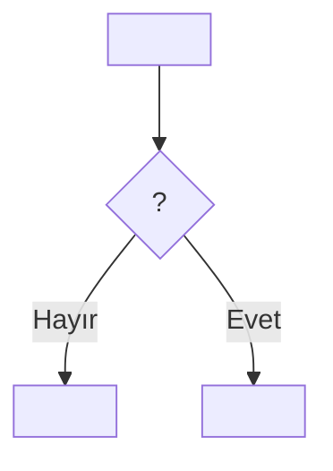

# PRD Skill'i

Kullanıcının tarif ettiği bir çözüm için kısa, kanıta dayalı bir PRD yazar ve Markdown (.md) dosyası olarak teslim eder. Çalışma dili Türkçe; ürün terimleri (PRD, MVP, JTBD) İngilizce kalabilir.

## Kesin kurallar

- Çıktı **her zaman bir Markdown dosyasıdır** (`prd-<kisa-konu>.md`). HTML sayfa, Word veya artifact üretme.
- **Tasarım veya prototip yapma.** Mockup, ekran çizimi, wireframe, renk/ölçü, component önerisi yok. Tasarım sistemi dokümanlarına yalnızca bir kısıtı anlamak için bakılabilir; PRD'ye tasarım detayı yazılmaz.
- **Hedef olmayanlar (non-goals) bölümü yazma.**
- **KPI / başarı metrikleri bölümü yazma.** Ölçüm planı, baseline, guardrail tablosu da yok.
- **Fonksiyonel gereksinim tablosu (FR-x) yazma.** Davranış kuralları kullanıcı hikayelerinin kabul kriterlerinde ve "Netleşen kararlar" listesinde yaşar.
- **Yalnızca çözümden etkilenen kullanıcıları dahil et.** Dolaylı fayda gören, ekranında değişiklik olmayan veya hiçbir şey görmeyen gruplar (ör. değişiklik görmeyen satıcı, sipariş numarasını bilen üçüncü kişi, özelliğin hiç gösterilmediği durumdaki kullanıcı) hedef kitleye ve hikayelere girmez.
- **Belirsiz bir noktayı sessizce varsayma.** Önce sor (aşağıya bak). Soru sonrasında hâlâ açık kalan her şey "Açık sorular"a girer.

## Akış

### 1. Bağlamı oku (soru sormadan önce)

- Bağlı bir proje varsa önce araştırma dokümanlarını oku (`project_search` / `project_read`): görüşme analizleri, içgörü raporları, transkriptler, önceki PRD'ler. Kullanıcının kastettiği problemi (ör. "dünkü transkriptlerde çıkan X sorunu") bu dokümanlarda bul.
- İlgili tema sayılarını (ör. 8/8), alıntıları ve geçici çözümleri (workaround) topla. Alıntıları transkriptten kelimesi kelimesine al.
- Tasarım sistemi dokümanı varsa yalnızca mevcut bir yüzeyin nasıl çalıştığını anlamak için (ör. sipariş takibi hangi bilgiyle sorgulanıyor) kullan. Plugin'le gelen sürüm: bu skill'in klasöründen `../../references/DESIGN.md` (kullanım kararları: `../../references/design-md-kararlari.md`).

### 2. Netleştirici soruları sor

`AskUserQuestion` aracıyla, en fazla 4 soruluk turlar halinde sor. Gerekirse ikinci bir tur yap. Her soruda:

- Neden önemli olduğunu tek cümleyle söyle, mümkünse kanıta bağla (ör. "başarısız iadelerde bu metin yanlış bilgi olur, görüşmelerde 7/8").
- 2–4 net seçenek ver; önerdiğin seçeneği ilk sıraya koy ve "(Önerilen)" ekle.
- Bir cevabın açık olmayan bir sonucu varsa (ör. "satıcı bazında kalıcı kapatma, aynı satıcıdan aylar sonraki yeni iadede de bildirimi gizler") sonraki turda **teyit sorusu** sor.
- Kullanıcının bir ifadesi birden fazla şekilde okunabiliyorsa (ör. "etkilenmeyen kullanıcıları çıkar") hangi öğeleri kastettiğini çoklu seçimle sor.

Tipik olarak netleştirilmesi gerekenler (konuya uyanları seç):

| Konu | Örnek soru |
|---|---|
| Tetikleyici durum | Hangi kayıt durumlarında gösterilir (başarılı / başarısız / bekleyen)? |
| Kimlik ve erişim | Login gerekli mi? Misafir nasıl sorguluyor? Kişisel veri (KVKK) nasıl korunacak? |
| Kapsam yeri | Hangi sayfalar, hangi satıcı/dükkan, hangi platform (web, mobil web, uygulama)? |
| Kalıcılık | Kapatma neyi kapsar (kayıt / satıcı / cihaz bazında)? Nerede saklanır? |
| Çoklu kayıt | Birden fazla kayıt varsa ne gösterilir (en güncel / toplu / ayrı ayrı)? |
| Süre | Ne zaman başlar, takvim günü mü iş günü mü, ne zaman biter? |
| Kısmi durumlar | Kısmi iade/tutar nasıl gösterilir (satır satır / toplam)? |
| Metin | Kullanıcının verdiği metin aynen mi kalacak, somut süre/aralık verilebilir mi? |

### 3. PRD'yi yaz

Aşağıdaki şablonu kullan. Bölüm sırasını ve başlıkları koru.

### 4. Teslim et

- Dosyayı `/mnt/user-data/outputs/prd-<kisa-konu>.md` olarak yaz (Write aracıyla).
- Bağlı bir proje varsa aynı içeriği projeye de kaydet (`project_write`, ör. `claude/prd-<kisa-konu>.md`).
- Cevapta: 1–2 cümle özet, ardından kullanıcının dikkat etmesi gereken en fazla 3 nokta (doğrulanmamış kritik varsayım, onay bekleyen öneri). Dosya içeriğini cevapta tekrar etme.

## Kanıt ve yazım kuralları

- Sayıları nitel örneklem diliyle yaz: "8 katılımcının 5'i" veya tabloda `5/8`. Yüzde kullanma.
- Her iddiaya kaynak göster (K1, K3 …). Kişisel verileri anonimleştir: katılımcı adı, dükkan adı, telefon, sipariş no yazma; yalnızca Kx kullan.
- Alıntıları değiştirme; kısaltırsan `[…]` kullan.
- Tek katılımcıdan gelen bulguyu göster ama "zayıf sinyal" diye işaretle.
- Kullanıcının söylediğini ve senin yorumunu ayır. Senin önerin olan her şeye "Önerim:" de veya Açık sorular'a koy.
- Kullanıcının varsayımlarını sorgula: çözümün kullanıcıya gerçekten ulaşıp ulaşmayacağını (ör. alıcı o sayfaya geri dönüyor mu?) ve kapsam dışında kalan en sert vakaları "Doğrulanmamış varsayımlar"da açıkça yaz, her biri için nasıl doğrulanacağını ekle.
- Kısa yaz: başlık, tablo, madde. Yönetici okuyabilmeli.

## Mermaid akışları

Çözümde **en az iki karar noktası** (koşul, dallanma, döngü) varsa her çözüm için bir akış ekle. Basit, tek adımlı bir değişiklikte akış ekleme.

- `flowchart TD` kullan.
- Adımlar `A["..."]`, kararlar `B{"...?"}` şeklinde, etiketler çift tırnak içinde.
- Etiket içinde düz çift tırnak (") kullanma; tırnak gerekiyorsa “ ” kullan. Kesme işareti için ’ kullan.
- Satır kırmak için `<br/>`.
- Dal etiketleri `-- Evet -->` / `-- Hayır -->`.
- Döngüleri kesikli okla göster: `K -.-> A`.
- Akış, "Netleşen kararlar" ve kabul kriterleriyle birebir tutarlı olmalı; akışta olup kararlarda olmayan bir kural yazma.
- Her akışın üstüne bir cümlelik açıklama yaz (ne zaman çalışır, neyi belirler).

## Şablon

````markdown
# PRD: <Özellik adı> — “<kullanıcının problem ifadesi>”

**Taslak v0.1** · **Tarih:** <GG Ay YYYY> · **Sahip:** <ad, rol> · **Kaynak:** <araştırma dokümanı, K1–Kn> · **İlgili içgörü:** <#n ad (skor)>

> <Tek cümle: kim, neyi, nerede, kime sormadan görebilecek / yapabilecek.>

## Netleşen kararlar (<tarih>)

- **<Konu>:** <Soru-cevap turunda verilen karar.>
- …

## 1. Amaç ve Problem Tanımı (Why)

### Problem

<2–4 cümle: bugün ne oluyor, kim etkileniyor, sonuç ne.>

**Problemin sahibi:** <Shopier ürünü / satıcı davranışı / ödeme-kargo altyapısı / bilgilendirme eksikliği> — <neyin kontrolümüzde olduğu, neyin olmadığı>.

### Kanıt

| Bulgu | Kapsam | Kaynak |
|---|---|---|
| <bulgu> | n/N | K1, K4 |

> “<kelimesi kelimesine alıntı […]>” — K1

> “<alıntı>” — K4

### Amaçlar

1. <Amaç>
2. <Amaç>

### Doğrulanmamış varsayımlar

- **<Varsayım veya kanıt boşluğu>.** <Neden riskli.> Doğrulama: <hangi veri/yöntemle>.
- **Kapsamda olmayan en sert vakalar.** <Kimler bu çözümden fayda görmeyecek ve neden.>

## 2. Hedef Kitle ve Kullanıcı Senaryoları

| Kullanıcı | İhtiyaç | Gördüğü yüzey |
|---|---|---|
| **<Etkilenen kullanıcı tipi>** — <tanım> | <ihtiyaç> | <yüzey> |

### Kullanıcı hikayeleri ve kabul kriterleri

#### US-1 · <Kullanıcı tipi, bağlam>

Bir <kullanıcı> olarak, <ihtiyaç> istiyorum, böylece <fayda>.

- **GIVEN** <ön koşul>
- **WHEN** <eylem>
- **THEN** <beklenen sonuç>
- **AND** <ek sonuç>

<Aynı hikayede ikinci senaryo varsa yeni bir GIVEN/WHEN/THEN bloğu ekle.>

## 3. Akışlar

### Çözüm 1 · <ad>

<Bir cümle açıklama.>



## Açık sorular

| # | Soru | Kime |
|---|---|---|
| 1 | <Soru. Varsa: Önerim: …> | <Product / Mühendislik / Hukuk / Ödeme …> |

---

Kaynaklar: <doküman yolları>. Katılımcılar K1–Kn olarak anonimleştirildi.
````

## Kontrol listesi (teslimden önce)

- [ ] Dosya .md mi, outputs klasöründe mi (ve varsa projede mi)?
- [ ] Tasarım/prototip, non-goals, KPI ve FR tablosu yok mu?
- [ ] Hedef kitlede ve hikayelerde yalnızca etkilenen kullanıcılar mı var?
- [ ] Her karar soru-cevaptan mı geliyor; geri kalanı Açık sorular'da mı?
- [ ] Alıntılar transkriptle birebir mi, kişisel veri yok mu?
- [ ] Akışlar kararlarla ve kabul kriterleriyle tutarlı mı, Mermaid sözdizimi kurallara uygun mu?